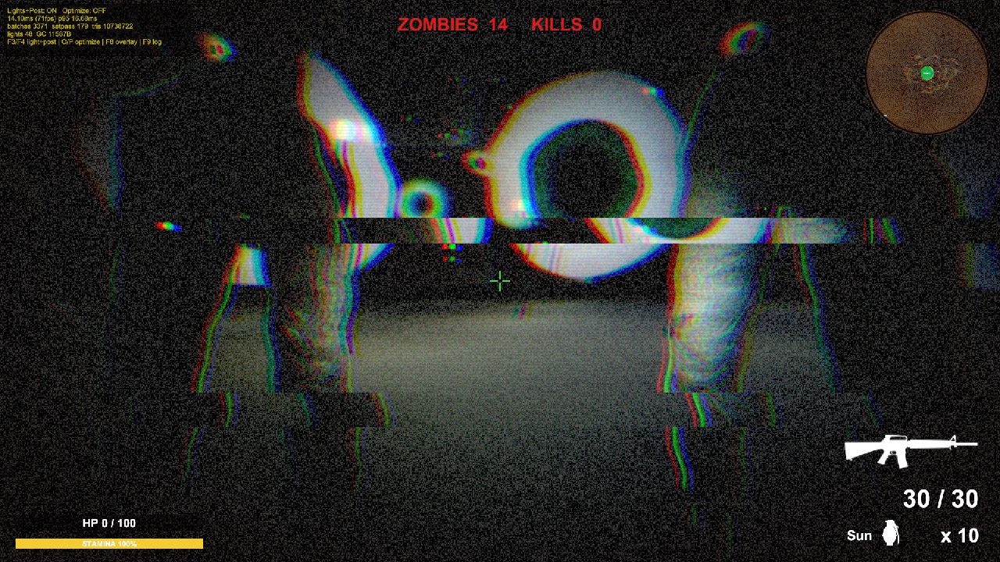
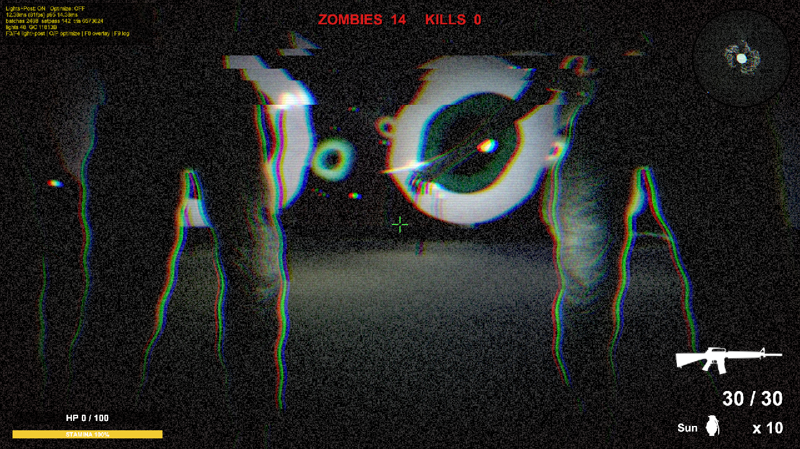
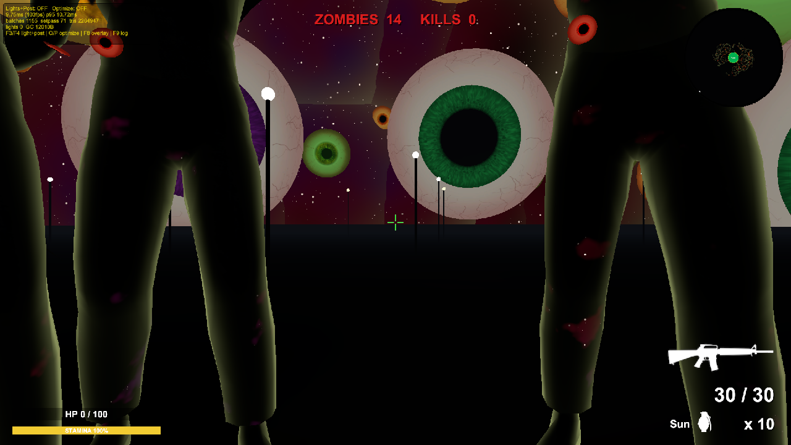
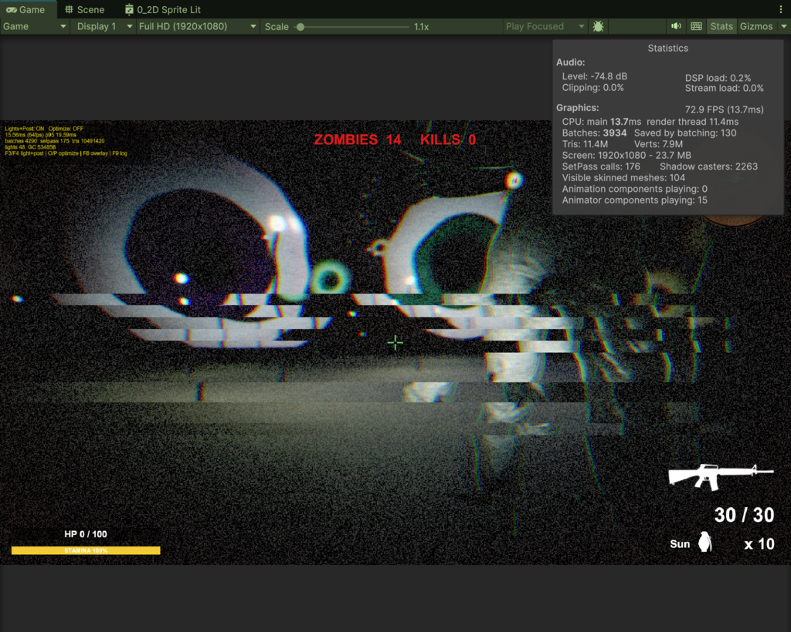
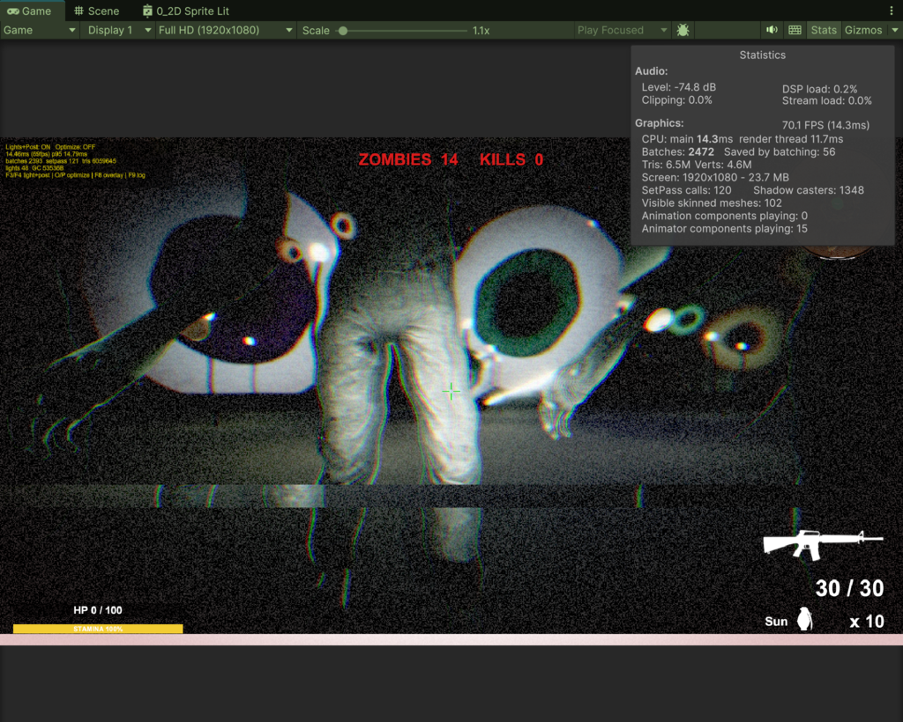
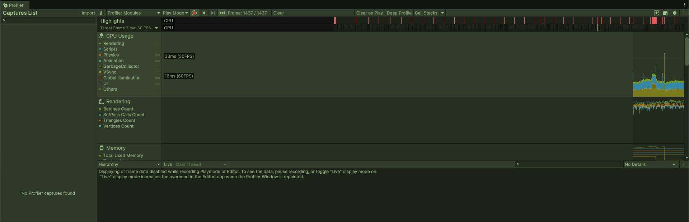
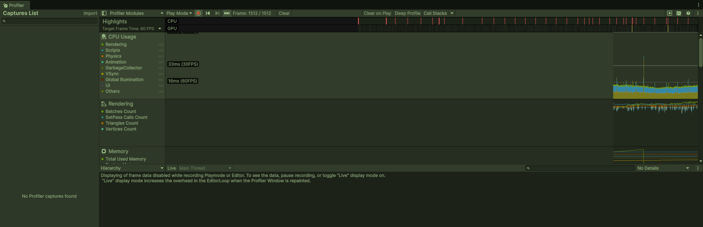

# 3DFPSgame 조명 · 포스트 프로세싱 · 최적화 보고서

작성일 2026-11-02 · Unity 6000.3.22f1 · URP 17.3.0 (Forward+) · 씬: `GameScene` (공포 숲)
측정 환경: Unity 에디터 Play 모드, Game 뷰 **Full HD(1920×1080)**, 별도 표기가 없으면 **프로파일러 녹화 끔**

> 이 문서의 모든 수치는 이 세션에서 실제로 실행해 얻은 값입니다. 실행하지 못했거나 적용하지 않은 항목은 "미적용" 또는 "미측정"으로 표시했습니다.

---

## 0. 요약 (노션 제출용 1페이지)

### 0.1 한 줄 결론
조명·그림자·텍스처 설정을 직접 측정하며 조정해 **GPU 시간 −39%, CPU 메인 −21%, 드로 콜 −38%, 삼각형 −46%, 텍스처 메모리 −62%**를 얻었습니다. 일부 시도(O 최적화의 프레임 이득, Mesh LOD)는 **기대만큼 개선되지 않아 원인을 분석했고, Mesh LOD는 채택하지 않고 되돌렸습니다.**

### 0.2 적용한 기법, 이유, 결과

| 분류 | 적용한 기법 | 왜 썼나 | 결과 (전 → 후) | 증거 |
|---|---|---|---|---|
| 조명 | 포인트 라이트 범위 36 → 22m | Forward+는 타일마다 라이트를 계산하므로 46개가 겹치면 픽셀당 라이트 수가 늘어남 | GPU 13.11 → 8.02ms (다른 변경과 합산) | 6.1, 6.4-B |
| 조명 | 그림자 맵 4096 → 2048, 거리 45 → 30m, 캐스케이드 4 → 2단 | 그림자 패스 횟수·캐스터 수·VRAM 감소. 어두운 분위기에서 먼 그림자는 안 보임 | Shadow casters 2,263 → 1,348 (−40%), VRAM −97MB | 6.4-B, 6.2 |
| 포스트 | SSAO 끄기 | 깊이·노멀 프리패스 + AO 풀스크린 패스 제거. 어두운 장면에서 시각 차이가 작음 | 드로 콜 감소에 기여(단독 효과는 미분리) | 4.2 |
| 포스트 | 나머지 효과(블룸·비네트·그레인·색수차·톤매핑·색 보정)는 **유지** | 공포 분위기를 만드는 핵심 | F3(전부 끔) 시 GPU 13.11 → 4.11ms | 6.1, 6.3 |
| CPU | 화면 밖 애니메이터 컬링, `LightFlicker` 정지 (O 키) | 보이지 않는 좀비 애니메이션·램프 노이즈 계산 제거 | CPU 메인 9.28 → 8.82ms (합산) | 6.1 |
| GPU | 먼 조명 끄기, 포인트/스팟 그림자 제거, HDR·렌더 스케일 등 (O 키) | 화면에 기여하지 못하는 조명·픽셀 비용 제거 | GPU 8.02 → 6.72ms, 프레임 12.38 → 11.39ms | 6.1 |
| RAM | 압축이 꺼진 텍스처 2장 압축(BC7), 3072→2048, 하늘 HDR 2048→1024 | 비압축 RGBA32 3072²는 96MB. 압축하면 같은 화질에서 1/9 | 텍스처 267.7 → 102.3MB (−62%), Unity 전체 할당 1,183 → 906MB (−23%) | 6.2-B |
| RAM/GPU | 메시 폴리곤 감축 | 캐릭터 50만, 검 45만 삼각형 | **미적용** (Blender 등 도구 없음). Mesh LOD는 시험 후 **되돌림** | 5.4 |

### 0.3 핵심 수치 (프로파일러 끔, Full HD)

| 항목 | 변경 전 | 변경 후(현재 기본값) | 변경 후 + O |
|---|---|---|---|
| 프레임 시간(평균) | 14.12 ms (71 fps) | 12.38 ms (81 fps) | 11.39 ms (88 fps) |
| GPU 시간 | 13.11 ms | 8.02 ms (−39%) | 6.72 ms (−49%) |
| CPU 메인 스레드 | 11.73 ms | 9.28 ms (−21%) | 8.82 ms (−25%) |
| 드로 콜 | 3,994 | 2,489 (−38%) | 2,262 (−43%) |
| 삼각형 | 1,031만 | 560만 (−46%) | 545만 (−47%) |
| 그래픽 드라이버 메모리 | 1,147 MB | 1,050 MB | 1,027 MB |

### 0.4 가장 중요한 발견
1. **프레임이 CPU에 묶여** 있어 GPU를 줄여도 CPU 시간(약 8~9ms) 아래로 내려가지 않습니다. 그래서 O 키의 이득은 −8%에 그쳤습니다.
2. 에디터에서 **프로파일러 녹화가 켜져 있으면** 0.5초마다 프레임이 21~35ms로 튑니다. 끄면 사라집니다(8절). 처음 보고한 p95 약 23ms는 이 때문이었습니다.
3. RAM은 **압축이 꺼진 텍스처 한 장(96MB)**이 가장 큰 낭비였고, 설정 하나로 해결됐습니다. 렌더링 설정 최적화는 RAM에 거의 영향을 주지 못했습니다.
4. **Mesh LOD**는 삼각형을 줄였지만(−42%) 프레임이 좋아지지 않았고 메시 메모리가 +25MB 늘어 **채택하지 않았습니다.**

### 0.5 노션에 첨부할 이미지

| 목적 | 파일 (`Assets/Screenshots/`) |
|---|---|
| 조명·화질 비교 (변경 전 / 후 / 조명 끔) | `m_A_original.png`, `m_C_new.png`, `m_B_f3.png` (참고: `m_D_new_opt.png`, `m_E_all_off.png`) |
| **Stats 창** 전후 | `prof_before_gamestats.png`, `prof_after_gamestats.png` |
| **Profiler 창** 전후 | `prof_before_profiler.png`, `prof_after_profiler.png` |
| RAM(텍스처 압축) 화질 전후 | `m_F_before_ram.png`, `m_F_after_ram.png` |
| Mesh LOD 실험(미채택) | `m_G_lod_off.png`, `m_G_lod_on.png` |

### 0.6 요약 수준의 한계
에디터 측정, 상태당 1회(오차 약 ±1~2ms), 변경 전 수치는 재현입니다. 자세한 한계는 10절입니다.

---

## 1. 조작키 (F3/F4, O/P)

| 키 | 동작 |
|---|---|
| **F3** | 모든 조명과 포스트 프로세싱 끄기 |
| **F4** | F3 이전 상태로 복원 |
| **O** | 런타임 최적화 적용(5절 표의 "O" 항목) |
| **P** | 최적화 해제(O 이전 값으로 복원) |
| F8 / F9 | 통계 오버레이 on/off / 현재 통계를 콘솔에 출력 |

구현: `Assets/02.Scripts/Game/RenderToggleController.cs`. 게임 시작 시 스스로 생성되고, 씬 파일은 수정하지 않습니다. 이 토글은 "조명과 포스트가 비용의 얼마를 차지하는가"를 재는 **측정 도구**입니다. 항상 켜 두는 기본값은 3.3절, 4.3절의 영구 변경이 담당합니다.

---

## 2. 측정 방법 (모든 비교에 공통)

- Play 모드, Game 뷰 **Full HD(1920×1080)** (Stats 창의 `Screen: 1920x1080`으로 확인), `Application.runInBackground = true`, **`ProfilerDriver.enabled = false`**.
- 상태를 바꾼 뒤 10초 안정화하고 300프레임의 평균 / p95 / 최대를 기록했습니다.
- CPU·GPU 시간은 `FrameTimingManager` 최근 40프레임 평균, 드로 콜·SetPass·삼각형은 `ProfilerRecorder`(Render 카테고리), 메모리는 `Profiler.GetTotal*MemoryLong`입니다.
- CPU와 GPU는 병렬로 도므로 **더해서 프레임 시간으로 쓰지 않습니다.**
- **변경 전**은 현재 URP 에셋과 조명을 Play 모드에서 원래 값(캐스케이드 4, 45m, 4096, SSAO 켜짐, 포인트 범위 36m)으로 되돌려 측정한 재현입니다. 포인트 라이트 범위는 평균 36m로 통일했으므로 실제 원본과 조금 다를 수 있습니다.
- 상태당 1회 측정이고 게임이 계속 진행되어 장면이 매번 조금씩 다릅니다. 오차는 약 ±1~2ms로 봐야 합니다.
- 화면 캡처(스크린샷)는 `capture_game_view`로, Stats·Profiler 창 캡처는 에디터 창의 화면 픽셀을 읽는 방식으로 했습니다.

---

## 3. 조명 (Lighting)

### 3.1 현재 씬의 조명 구성 (실측)

| 요소 | 상태 | 값 |
|---|---|---|
| Directional Light (태양) | **Mixed** (Baked Indirect), Soft 그림자 | 1개, 세기 2 |
| Point Light (가로등·램프) | **Realtime**, 그림자 없음 | 46개, 범위 약 36m, 세기 약 150 |
| Spot Light | **Realtime**, Soft 그림자 | 1개, 범위 45m |
| **Lightmap** | 베이크됨 | 1장 (2048, EXR 약 2.8MB), 라이트맵을 쓰는 렌더러 1개 |
| **Light Probe** | 베이크됨 | Light Probe Group 1개, 프로브 338개 |
| Reflection Probe | 씬에 0개 | 베이크 폴더에 `ReflectionProbe-0.exr`이 있으나 씬에서 쓰이지 않음 |
| Static (GI·배칭·오클루디) | 93 / 429 렌더러 | 정적 지오메트리만 베이크에 참여 |
| 환경광 / 하늘 / 안개 | Trilight / `UnearthlyRed4k` HDRI / Exponential Squared | |
| 오클루전 컬링 | 카메라에서 켜짐 | `GameScene`에는 베이크된 오클루전 데이터 에셋이 없음(`Culling Test Scene`에만 있음) |
| 라이팅 설정 | `HorrorForestLighting.lighting` | Baked Indirect, 베이크 AO 켜짐, 바운스 2, 라이트맵 최대 2048 |

### 3.2 왜 이렇게 구성했나 (Realtime / Baked / Mixed)

| 기법 | 쓰는 곳 | 이유 |
|---|---|---|
| **Realtime** | 포인트 라이트 46개, 스팟 | 램프가 `LightFlicker`로 **런타임에 세기를 바꿉니다.** 베이크된 조명은 런타임에 바꿀 수 없으므로 실시간이어야 합니다. 좀비·플레이어 같은 동적 오브젝트에도 즉시 조명이 적용됩니다. |
| **Mixed (Baked Indirect)** | 태양 | 간접광과 바운스는 라이트맵에 구워 비용을 없애고, 직접광과 그림자는 실시간으로 남겨 **움직이는 좀비가 그림자를 받게** 합니다. |
| **Lightmap** | 정적 오브젝트 93개 | 정적 지형·구조물의 간접광을 텍스처에 저장해 실시간 GI 계산이 필요 없습니다. 비용은 라이트맵 텍스처 약 2.8MB뿐입니다. |
| **Light Probe** | 338개 | 라이트맵은 움직이는 오브젝트에 적용되지 않으므로, 프로브로 **좀비·플레이어가 베이크된 간접광을 받게** 합니다. |
| **그림자** | 태양·스팟 | 공포 분위기의 대비를 만듭니다. 포인트 라이트 46개에는 그림자를 쓰지 않습니다(그림자가 켜지면 라이트당 최대 6면 렌더링). |
| **오클루전 컬링** | 카메라 | 가려진 오브젝트의 렌더링을 건너뜁니다. 다만 `GameScene`에는 베이크 데이터가 없어 현재는 효과가 없을 가능성이 큽니다(미검증). |

### 3.3 이번에 조정한 조명 값과 이유 (영구 적용)

| 항목 | 변경 전 | 변경 후 | 이유 | 적용 위치 |
|---|---|---|---|---|
| 포인트 라이트 범위 | 약 36m | **22m** | Forward+는 화면 타일마다 영향을 주는 라이트를 계산합니다. 범위가 36m이면 46개가 서로 크게 겹쳐 픽셀당 라이트 수가 늘어납니다. 범위를 줄이면 타일당 라이트가 줄어듭니다. | `RenderToggleController.Start()` (실행 중에만, 씬 불변) |
| 메인 그림자 맵 | 4096 | **2048** | 그림자 맵 렌더링 비용과 VRAM이 해상도의 제곱에 비례합니다. | `PC_RPAsset.asset` |
| 그림자 거리 | 45m | **30m** | 플레이 시야에서 먼 그림자는 어두운 분위기에서 거의 보이지 않습니다. 그림자 캐스터 수가 줄어듭니다. | `PC_RPAsset.asset` |
| 그림자 캐스케이드 | 4단 | **2단** | 캐스케이드 하나가 장면을 한 번 더 그림자 패스로 렌더링합니다. 단수만큼 드로 콜이 늘어납니다. | `PC_RPAsset.asset` |

### 3.4 조명 Before / After

- `F3` 비교가 곧 "조명 전체 비용" 증거입니다. 조명 48개 → 0개에서 GPU 13.11 → 4.11ms, 삼각형 1,031만 → 225만(그림자 패스 포함)입니다(6.1절).
- 영구 변경(3.3절)의 효과는 6.1절의 "변경 전 → 현재 기본값"입니다. **포인트 범위·그림자 3항목·SSAO를 한꺼번에 바꿔 측정했으므로 각각의 개별 기여는 분리하지 못했습니다**(미측정). 한 항목씩 끄는 실험을 시도했으나 그 시점에 에디터가 메모리 부족으로 멈춰 결과를 얻지 못했습니다.
- 라이트맵 / 프로브 / Mixed 구성은 **바꾸지 않았습니다.** 램프를 베이크하면 비용은 크게 줄지만 `LightFlicker` 연출이 사라지므로(3.2절), 이 프로젝트에서는 실시간 유지가 맞다고 판단했습니다. 정적 오브젝트 비율이 93/429라서 라이트맵 확대 여지도 작습니다.

---

## 4. 포스트 프로세싱 (Post Processing)

### 4.1 적용된 효과와 현재 값 (`HorrorForestVolume.asset`)

| 효과 | 주요 값 | 목적 |
|---|---|---|
| **Color Adjustments** | 노출 +1.8, 대비 +28, 채도 −48 | 채도를 낮춰 차갑고 탁한 공포 색감을 만들고, 대비로 어둠을 강조 |
| **White Balance** | 온도 −18, 틴트 +6 | 푸른 기가 도는 차가운 톤 |
| **Shadows/Midtones/Highlights** | 그림자 쪽에 청록 계열 보정 | 어두운 영역에 색을 넣어 암부가 죽지 않게 함 |
| **Tonemapping** | ACES | 밝은 광원이 하얗게 터지는 것을 완만하게 압축 |
| **Bloom** | 임계값 0.8, 세기 0.9, 산란 0.75 | 램프·눈 모양 광원에 번짐을 주어 빛의 존재감을 키움 |
| **Vignette** | 세기 0.48, 부드러움 0.55 | 시야 가장자리를 어둡게 해 시선을 중앙에 모으고 폐쇄감을 줌 |
| **Film Grain** | 세기 0.5, 반응 0.7 | 거친 필름 질감, 어둠 속 불안감 |
| **Chromatic Aberration** | 0.15 | 가장자리 색 번짐으로 광기·왜곡 연출 |
| **Ambient Occlusion (SSAO)** | 렌더러 피처, 세기 2, 반경 0.45 | 접촉부·구석의 음영으로 입체감 보강 |
| **ColossusGlitch** | 풀스크린 렌더러 피처 | 거대 몬스터 등장 시 화면 글리치 연출 |

### 4.2 비교와 판단 (직접 비교 후 선택)

| 비교 | 결과 | 판단 |
|---|---|---|
| 포스트 전체 ON/OFF (F3 / F4) | OFF 시 평면적인 무조명 화면, 그레인·색수차·글리치·비네트가 사라짐 | 포스트가 이 게임의 분위기를 거의 전부 만듭니다. **효과 자체는 유지**합니다. |
| SSAO 켬/끔 | 끄면 깊이·노멀 프리패스와 AO 풀스크린 패스가 사라져 드로 콜이 줄어듦. 어두운 공포 장면에서 접촉부 음영 차이는 육안으로 눈에 띄지 않았음 | **SSAO만 영구로 끔.** 비용 대비 시각 이득이 작다고 판단 |
| 나머지(그레인, 색수차, 비네트, 블룸, 톤매핑 등) | 대부분 풀스크린 픽셀 연산이라 GPU 비용은 있으나, 게임 정체성(공포 연출)이므로 | **유지** |

### 4.3 포스트 프로세싱 Before / After

| 구분 | 변경 전 | 변경 후 | F3(전부 끔) |
|---|---|---|---|
| SSAO | 켜짐 | **꺼짐(영구)** | 꺼짐 |
| 나머지 8개 볼륨 효과 | 켜짐 | 켜짐(값 불변) | **꺼짐** |
| ColossusGlitch | 켜짐 | 켜짐 | **꺼짐** |
| 안티앨리어싱 | 카메라 설정 | 동일 | 꺼짐 |

수치 증거는 6.1절입니다. 포스트 효과의 값(노출, 대비, 블룸 세기 등)은 **이번에 AI로 튜닝하지 않았습니다.** 기존 값을 그대로 두고 켜고 끄는 비용만 측정했습니다.

---

## 5. 최적화 기법 전체 목록과 선택 이유

관점별로 "무엇을, 왜"를 정리했습니다. **영구** = 설정 파일 또는 시작 코드로 항상 적용, **O** = O 키로 켜는 런타임 최적화, **미적용** = 후보로 식별만 함.

### 5.1 GPU 최적화 (렌더링)

| 기법 | 상태 | 왜 이 기법을 썼나 | 근거 / 측정 |
|---|---|---|---|
| 그림자 맵 4096 → 2048 | 영구 | 해상도의 제곱에 비례하는 그림자 렌더링·VRAM 비용 절감 | 그래픽 드라이버 메모리 1,147 → 1,050MB(−97MB, 다른 변경과 합산) |
| 그림자 거리 45 → 30m, 캐스케이드 4 → 2 | 영구 | 그림자 패스 횟수와 캐스터 수 감소. 어두운 분위기에서 먼 그림자는 안 보임 | 드로 콜 −38%(합산), Shadow casters −40% |
| SSAO 끄기 | 영구 | 깊이·노멀 프리패스 + 풀스크린 AO 패스 제거 | 6.1절 (합산) |
| 포인트 라이트 범위 36 → 22m | 영구 | Forward+ 타일당 라이트 수 감소 | 6.1절 GPU −39% (합산) |
| 먼 포인트/스팟 조명 끄기(30m), 포인트/스팟 그림자 제거, 추가 조명 4개 상한 | **O** | 화면에 영향을 못 주는 조명 계산을 제거. 활성 조명 48 → 13 | B → B+O: GPU 8.02 → 6.72ms |
| HDR 끔, 렌더 스케일 0.85, MSAA 1 | **O** | 픽셀 수·정밀도 비용 절감(화질 비용 있음) | B → B+O (합산) |
| LOD 바이어스 0.6, 이방성 필터링 끔, 소프트 파티클 끔, 실시간 반사 프로브 끔, 2본 스키닝 | **O** | 멀리 있는 오브젝트의 정점·텍스처 비용 절감 | B → B+O (합산) |
| Mesh LOD(캐릭터·검) | **시험 후 되돌림** | 캐릭터 50만·검 45만 삼각형을 거리에 따라 줄이려는 시도 | 삼각형은 줄었으나 프레임 개선 없음, 메모리 증가(5.4절) |
| 드로 콜 감소(정적 배칭 확대, `CosmicColossus` 눈 렌더러 약 229개 병합, GPU 인스턴싱) | **미적용** | 프레임이 CPU에 묶여 있고 드로 콜이 약 2,500개로 가장 큰 남은 비용 | 렌더러 470개 → 드로 콜 약 4,000개(렌더러당 약 9). 정적 배칭 대상 93개뿐 |

### 5.2 CPU 최적화 (스크립트)

| 기법 | 상태 | 왜 이 기법을 썼나 | 근거 / 측정 |
|---|---|---|---|
| 드로 콜 감소(위 5.1 영구 항목) | 영구 | 그림자·SSAO 패스가 줄면 CPU의 컬링·드로 호출 제출 비용도 함께 줄어듦 | CPU 메인 11.73 → 9.28ms (−21%) |
| 화면 밖 애니메이터 컬링 | **O** | 보이지 않는 좀비의 애니메이션 평가를 건너뜀 | B → B+O: CPU 메인 9.28 → 8.82ms (합산) |
| `LightFlicker` 정지 | **O** | 램프 약 90개가 매 프레임 `Mathf.PerlinNoise`와 `Random.value`를 호출 | B → B+O (합산) |
| 통계 오버레이 `OnGUI` 할당 제거 | 영구(내 도구 수정) | 오버레이가 프레임마다 `float[300]` 정렬과 `FindObjectsByType`로 할당함. 측정 도구가 측정값을 오염시키지 않도록 0.5초마다 한 번만 계산하게 수정 | 프레임당 GC 할당이 오버레이 수정 직후 약 12KB로 측정됨(이후 게임 활동에 따라 약 37~100KB로 변동) |
| **프레임당 GC 할당 약 68KB** 원인 제거 | **미적용** | 초당 약 4MB 할당 → GC 스파이크 위험 | 모든 상태에서 비슷한 크기. 이번 변경과 무관한 게임 코드 유래이며 출처 미확인 |

### 5.3 RAM 최적화 (에셋)

실제 로드된 에셋의 메모리를 측정한 뒤(에디터 기준, `Assets/` 하위만), 메모리를 가장 많이 쓰는 에셋부터 골랐습니다. 텍스처는 **GPU에 올라가는 크기**가 비압축이면 `가로×세로×4바이트`(+밉맵 33%)라서 해상도가 크고 압축이 꺼져 있으면 비용이 큽니다.

| 에셋 | 원래 상태 | 원인 | 적용한 변경 | 전 → 후 | 상태 |
|---|---|---|---|---|---|
| `NEFASA_Eyes/Textures/Iris_Structure.png` | 3072², **비압축 RGBA32** | 임포트 설정이 `Uncompressed`. 3072는 2의 거듭제곱이 아니라 `CompressedHQ`만 바꿔서는 압축이 적용되지 않았음(RGBA32 그대로 확인) | 압축 `CompressedHQ`(BC7) + 최대 크기 **2048** | 96.1 → **10.7 MB** | **적용** |
| `NEFASA_Eyes/Textures/Sclera_Vessels.png` | 2048², **비압축 RGB24** | 임포트 설정이 `Uncompressed` | 압축 `CompressedHQ`(BC7) | 37.4 → **10.7 MB** | **적용** |
| `SkySeries Freebie/.../UnearthlyRed4k.hdr` | 큐브맵 2048² 면, BC6H | 이미 압축됨. 면 해상도만 큼 | 최대 크기 **1024** (면 하나가 90° 시야를 덮으므로 720p~1080p에서는 거의 1:1) | 64.1 → **16.1 MB** | **적용** |
| `Green Armored Figure` (플레이어 캐릭터 메시) | 정점 370,592, 삼각형 500,000, 본 22개 | 고해상도 단일 메시 | 폴리곤 감축은 도구가 없어 못 함. Mesh LOD 시험(5.4절) 후 되돌림 | 68 MB | **미적용** |
| `Ornate Green Glowing Sword` (검 메시) | 정점 289,495, 삼각형 451,012 | 동일 | 동일 | 36.8 MB | **미적용** |
| 오디오 | 로드된 클립 없음 | | | 0 MB | 해당 없음 |

- 텍스처 3장 합계: 약 197.6 → 약 37.5MB. 프로젝트 전체 텍스처(에셋 32개): **267.7 → 102.3MB**(Play 모드 측정, 6.2-B절).
- **화질 영향:** Iris는 3072 → 2048로 해상도가 낮아지고 BC7로 압축되며, 하늘은 면 해상도가 절반이 됩니다. Play 화면에서 눈 모양과 하늘의 차이는 육안으로 눈에 띄지 않았습니다(6.3절). 1080p 이상에서 하늘이 약간 부드러워질 수 있습니다(미검증).
- 메시를 적용하지 못한 이유: 폴리곤 감축은 모델 품질을 직접 바꾸고, 이 PC에는 Blender 같은 감축 도구가 설치돼 있지 않았습니다(확인함). 임포트 설정만으로 줄일 수 있는 항목(블렌드 셰이프는 0개, 탄젠트는 노멀 맵에 필요)은 없었습니다. 버텍스 데이터는 캐릭터 약 24MB, 검 약 13MB입니다.

### 5.4 메시 최적화 실험: Mesh LOD (시험 후 채택하지 않음)

Unity 6.3의 모델 임포터에는 **Mesh LOD 자동 생성**(`generateMeshLods`)이 있습니다. 폴리곤 감축 도구가 없어서, 임포트 설정만으로 되돌릴 수 있는 이 기능을 켜서 측정했습니다.

**생성된 LOD (삼각형 수)**

| 메시 | LOD0 | LOD1 | LOD2 | LOD3 | … | 최저 |
|---|---|---|---|---|---|---|
| 플레이어 캐릭터 (LOD 16단계) | 500,000 | 257,294 | 137,536 | 89,826 | … | 68 |
| 검 (LOD 15단계) | 451,012 | 229,250 | 118,206 | 63,270 | … | 64 |

**같은 방식으로 Play 모드 A/B 측정 (프로파일러 끔)**

| 항목 | LOD 끔 | LOD 켬 | 해석 |
|---|---|---|---|
| 삼각형 | 6.08 M | **3.50 M (−42%)** | 감소 |
| 드로 콜 | 2,438 | 3,048 | 오히려 증가(씬 변동으로 추정, 미확인) |
| 프레임 평균 / p95 | 11.45 ms / 13.59 | 12.13 ms / 14.29 | 개선 없음 |
| CPU 메인 | 7.53 ms | 9.62 ms | 개선 없음 |
| 그래픽 드라이버 메모리 | 859 MB | 825 MB | 의미 있는 차이 없음 |
| 메시 메모리 (캐릭터 / 검) | 68.0 / 36.8 MB | **82.2 / 48.1 MB (+25MB)** | **증가** (LOD 인덱스 데이터가 추가됨) |
| GPU 시간 | 3.50 ms | 7.81 ms | 이 GPU 값은 에디터에서 신뢰하기 어려워 판단에 쓰지 않음 |

**판단: 채택하지 않고 되돌렸습니다.**
- 삼각형은 줄었지만 **프레임 시간은 좋아지지 않았고**, 이 씬은 CPU 병목이라 삼각형 감소의 이득이 드러나지 않습니다.
- **RAM이 목표인데 메시 메모리가 늘어납니다**(+25MB). Mesh LOD는 메모리 절감 기법이 아닙니다.
- 단 두 측정의 씬 상태(좀비 위치·수)가 달라 오차가 큽니다. LOD가 프레임에 해로웠다고 단정하지 않고, **이 조건에서는 이득을 증명하지 못했다**고만 결론 냅니다(반복 측정은 하지 못했음).
- FBX `.meta`는 원래대로 복원했습니다(git 변경 없음 확인). 스크린샷: `m_G_lod_off.png`, `m_G_lod_on.png`.
- 메모리를 실제로 줄이려면 원본 메시의 폴리곤을 줄여야 합니다(Blender 등 외부 도구 필요, 10절).

---

## 6. 증거: 전후 측정 결과

### 6.1 상세 측정표 (Stats)

| 상태 | 평균 ms (fps) | p95 | 최대 | CPU 메인 | CPU 렌더 | GPU | 드로 콜 | SetPass | 삼각형 | 활성 조명 |
|---|---|---|---|---|---|---|---|---|---|---|
| A 변경 전 | 14.12 (71) | 16.68 | 18.62 | 11.73 | 4.16 | 13.11 | 3,994 | 179 | 1,031만 | 48 |
| A + F3 | 9.72 (103) | 10.71 | 13.19 | 7.15 | 3.51 | 4.11 | 1,137 | 70 | 225만 | 0 |
| B 현재 기본값 | 12.38 (81) | 14.38 | 20.26 | 9.28 | 3.89 | 8.02 | 2,489 | 141 | 560만 | 48 |
| B + O | 11.39 (88) | 12.72 | 15.44 | 8.82 | 3.86 | 6.72 | 2,262 | 132 | 545만 | 13 |
| B + O + F3 | 11.47 (87) | 13.14 | 14.78 | 8.35 | 4.25 | 3.92 | 1,135 | 69 | 221만 | 0 |

(단위 ms. 드로 콜·SetPass·삼각형은 그림자 패스를 포함한 렌더링 전체 값입니다.)

### 6.2 메모리 (RAM / VRAM)

| 상태 | Unity 전체 할당 | 그래픽 드라이버 | Mono 힙 사용 | 프레임당 GC 할당 |
|---|---|---|---|---|
| A 변경 전 | 5,395 MB | 1,147 MB | 1,107 MB | 약 68.8 KB |
| B 현재 기본값 | 5,383 MB | 1,050 MB | 1,083 MB | 약 68.8 KB |
| B + O | 5,388 MB | 1,027 MB | 1,112 MB | 약 68.3 KB |
| B + O + F3 | 5,393 MB | 1,003 MB | 1,148 MB | 약 68.2 KB |

- 그래픽 드라이버 메모리가 약 100~145MB 줄었습니다(그림자 맵 축소, SSAO 렌더 타깃 제거 등).
- **이 표의 "Unity 전체 할당 약 5.4GB"는 절대값으로 쓰면 안 됩니다.** 이 측정 세션의 에디터에는 이전에 켜져 있던 프로파일러 녹화 데이터 등이 쌓여 있었습니다(6.2-B에서 새 Play 세션으로 다시 재니 1.2GB 수준). 이 표는 **같은 세션 안의 상태끼리 비교**하는 용도로만 유효하고, 그 비교에서는 전체 할당이 변하지 않았습니다(이 시점에는 에셋 변경 전이므로 당연함).
- Mono 힙 ±50MB는 측정 시점의 게임 활동에 따른 변동으로, 효과로 해석하지 않습니다.

### 6.2-B RAM 최적화(텍스처) Before / After

텍스처 임포트 설정만 바꾸고 나머지(조명·그림자·SSAO 현재 기본값)는 동일하게 둔 채, **새 Play 세션 두 번**에서 같은 방법으로 측정했습니다. Before는 임포트 설정을 일시적으로 원래 값으로 되돌려 잰 값이며, 측정 후 최적화 설정을 다시 적용하고 확인했습니다(9절).

| 항목 | Before (원래 임포트) | After (압축·크기 조정) | 변화 |
|---|---|---|---|
| 텍스처 메모리(에셋 32개) | 267.7 MB | **102.3 MB** | **−165 MB (−62%)** |
| Unity 전체 할당 (`GetTotalAllocatedMemory`) | 1,183 MB | **906 MB** | **−277 MB (−23%)** |
| Unity 예약 메모리 (`GetTotalReservedMemory`) | 1,690 MB | **1,437 MB** | −253 MB (−15%) |
| 그래픽 드라이버(VRAM) 메모리 | 788 MB | **700 MB** | −88 MB (−11%) |
| 시스템 사용 메모리(`System Used Memory`) | 4,217 MB | **3,886 MB** | −331 MB (−8%) |
| Mono 힙 | 1,091 MB | 1,091 MB | 0 (스크립트 메모리는 무관) |
| 프레임 시간 평균 / p95 | 11.22 ms / 12.08 | 12.99 ms / 14.70 | +1.8ms (아래 참고) |
| GPU 시간 | 8.24 ms | 8.77 ms | +0.5ms (아래 참고) |
| 드로 콜 / SetPass / 삼각형 | 2,738 / 127 / 665만 | 2,551 / 124 / 655만 | 변화 없음(변동 범위) |

- **RAM과 VRAM은 확실히 줄었고, 프레임 시간은 개선되지도 않았습니다.** 텍스처 압축의 목적은 메모리이지 프레임이 아닙니다. 이론적으로는 압축 텍스처가 샘플링 대역폭을 줄여 GPU에 소폭 유리하지만, 이 씬에서는 GPU 병목이 텍스처가 아니라 조명·그림자라서 효과가 보이지 않습니다.
- 프레임 시간이 After에서 1.8ms 더 나온 것은 **최적화의 역효과로 해석하지 않습니다.** 두 측정은 각각 1회이고 좀비 위치·수가 달랐으며, 텍스처 압축이 프레임을 늘릴 이유가 없습니다. Before 측정에는 로딩 직후의 58ms 스파이크(최대값)도 섞여 있습니다. 반복 측정으로 확인하지는 못했습니다(미검증).
- 이 측정에서도 **메시 메모리(약 110MB)와 GC 할당(프레임당 약 68KB)은 그대로**입니다.

### 6.3 화면 스크린샷 (조명·그래픽 품질 비교)

| 상태 | 파일 |
|---|---|
| A 변경 전 | `Assets/Screenshots/m_A_original.png` |
| A + F3 | `Assets/Screenshots/m_B_f3.png` |
| B 현재 기본값 | `Assets/Screenshots/m_C_new.png` |
| B + O | `Assets/Screenshots/m_D_new_opt.png` |
| B + O + F3 | `Assets/Screenshots/m_E_all_off.png` |
| 텍스처 압축 전 / 후 | `Assets/Screenshots/m_F_before_ram.png` / `m_F_after_ram.png` |
| Mesh LOD 끔 / 켬 | `Assets/Screenshots/m_G_lod_off.png` / `m_G_lod_on.png` |

- 변경 전과 현재 기본값은 그레인, 색수차, 비네트, 글리치, 어두운 분위기가 동일하게 유지됩니다. 육안으로 눈에 띄는 차이는 없습니다. 먼 곳 그림자 정밀도와 SSAO 접촉부 음영은 약해졌을 수 있습니다.
- F3은 평면적인 무조명 화면입니다. 스카이박스와 이미션 오브젝트(눈 모양, 가로등 점)만 보이고 조명을 받는 면은 검게 변합니다.
- 텍스처 압축 전후 두 화면 모두 눈 모양과 하늘 질감이 동일한 분위기로 보이고, 압축으로 인한 눈에 띄는 열화는 확인하지 못했습니다(서로 다른 시점이라 픽셀 단위 비교는 아님).
- 스크린샷은 서로 다른 시점에 찍어 좀비와 카메라 위치가 정확히 같지 않습니다. 각 화면 좌상단 노란 오버레이가 그 시점의 FPS·Batches·SetPass·Tris입니다.

### 6.4 Stats 창 · Profiler 창 캡처

Stats 창과 Profiler 창은 에디터 창의 화면 픽셀을 읽어 PNG로 저장하는 방식으로 캡처했습니다. 화면에 보이는 그대로 읽으므로 **Unity 창이 맨 앞에 있어야** 합니다. 다른 프로그램 창이 겹쳐 찍힌 시도 2회는 삭제했고, Unity 창을 앞에 둔 상태에서 정상 캡처했습니다. 캡처 시에만 프로파일러 녹화를 잠깐 켰습니다.

| 상태 | Stats 창 | Profiler 창 |
|---|---|---|
| 변경 전 (원래 렌더 설정 + 원래 텍스처) | `prof_before_gamestats.png` | `prof_before_profiler.png` |
| 변경 후 (현재 기본값) | `prof_after_gamestats.png` | `prof_after_profiler.png` |

### 6.4-B Stats 창 전후 비교 (프로파일러 녹화 켠 상태, Full HD)

| Statistics 항목 | 변경 전 | 변경 후 | 변화 |
|---|---|---|---|
| FPS (프레임 시간) | 72.9 (13.7 ms) | 70.1 (14.3 ms) | 차이 없음(변동 범위) |
| CPU main | 13.7 ms | 14.3 ms | 차이 없음 |
| Render thread | 11.4 ms | 11.7 ms | 차이 없음 |
| **Batches** | 3,934 | **2,472** | **−37%** |
| Saved by batching | 130 | 56 | |
| **Tris** | 11.4 M | **6.5 M** | **−43%** |
| **Verts** | 7.9 M | **4.6 M** | **−42%** |
| **SetPass calls** | 176 | **120** | **−32%** |
| **Shadow casters** | 2,263 | **1,348** | **−40%** |
| Visible skinned meshes | 104 | 102 | 변화 없음 |

**읽는 법과 주의**
- 렌더링 카운트(Batches, Tris, Verts, SetPass, Shadow casters)는 모두 눈에 띄게 줄었습니다. 6.1절의 드로 콜·삼각형 감소와 같은 방향이며, 그림자 캐스터가 40% 줄어든 것이 직접적인 이유입니다(그림자 거리 45 → 30m, 캐스케이드 4 → 2단).
- **그러나 이 캡처에서는 FPS와 CPU 시간이 개선되지 않았습니다**(72.9 → 70.1 FPS). 6.1절 표(프로파일러 끔)에서는 CPU 메인이 11.73 → 9.28ms로 줄었는데, 이 캡처와 모순처럼 보입니다. 원인은 **프로파일러 녹화 자체의 비용**으로 판단합니다. 녹화가 켜져 있으면 프로파일러가 매 프레임 수많은 계측 지점을 기록하므로 CPU 시간이 렌더링 부하가 아니라 계측 비용 위주로 채워져, 렌더 작업이 줄어도 프레임 시간에 잘 드러나지 않습니다(8절의 0.5초 스파이크와 같은 계열의 영향). 이 가설을 직접 검증하지는 않았습니다(미검증).
- 그래서 **프레임 시간·CPU/GPU 시간은 6.1절(프로파일러 끔)을 기준으로 하고, 이 Stats 캡처는 "카운트가 실제로 줄었다"는 화면 증거로만** 사용합니다.

### 6.5 이미지 읽는 법 (각 캡처에서 무엇을 보면 되나)

**Stats 창(Statistics)** — Game 뷰 우상단 Stats 버튼으로 표시됩니다.

| 줄 | 의미 | 이 보고서에서의 해석 |
|---|---|---|
| FPS (ms) | 프레임당 걸린 시간 | 클수록 느림. 16.6ms 이하여야 60fps. 이 캡처는 프로파일러 녹화 중이라 비교 기준으로 쓰지 않음 |
| CPU main / render thread | 메인 스레드와 렌더 스레드의 CPU 시간 | 둘 중 큰 쪽이 CPU 병목. 렌더 스레드 11ms대가 항상 높아 **드로 콜 제출이 병목**임을 시사 |
| Batches | 배칭 후 실제 드로 호출 묶음 수 | 3,934 → 2,472. 그림자·SSAO 패스가 줄어 감소 |
| Saved by batching | 배칭으로 절약한 호출 수 | 참고용 |
| Tris / Verts | 그린 삼각형·정점 수(그림자 패스 포함) | 11.4M → 6.5M. 그림자 패스가 줄어든 효과가 큼 |
| SetPass calls | 셰이더·머티리얼 상태 전환 횟수 | 176 → 120. 값이 클수록 CPU 비용이 큼 |
| Shadow casters | 그림자 패스에서 그려지는 오브젝트 수 | 2,263 → 1,348. 그림자 거리·캐스케이드 축소의 직접 증거 |
| Visible skinned meshes | 화면에 보이는 스킨드 메시 수 | 거의 변화 없음(좀비 수는 그대로) |

**Profiler 창** — 위에서 아래로:

| 영역 | 보는 법 |
|---|---|
| 상단 Highlights (CPU / GPU 막대) | 프레임마다 한 칸. **빨간 눈금은 목표(60fps, 16ms)를 넘긴 프레임**입니다. 전후 눈금 밀도 차이를 이 문서는 주장하지 않습니다(녹화 중에는 둘 다 흔들림). |
| CPU Usage | Rendering / Scripts / Physics / Animation / GarbageCollector 등이 쌓인 면적 그래프. 가로선 33ms(30FPS), 16ms(60FPS)와 비교해서 봅니다. 면적의 대부분이 Rendering(파랑)과 Others(올리브)로 보여 **스크립트가 아니라 렌더링 쪽이 시간을 씀**을 확인할 수 있습니다. |
| Rendering | Batches / SetPass / Triangles / Vertices 카운트 그래프. 수치 비교는 Stats 창이 더 정확합니다. |
| Memory | Total Used Memory 그래프. 선이 평평하면 메모리가 계속 늘지 않는다는 뜻입니다. |
| 하단 Hierarchy | 녹화 중에는 "Displaying of frame data disabled"가 표시되어 표가 비어 있습니다. 항목별 ms 표가 필요하면 녹화를 멈추고 프레임을 선택해야 합니다(이 보고서에는 포함하지 못함). |

**화면 스크린샷** — 좌상단의 노란 글씨는 제가 만든 오버레이(F8)이고, 그 시점의 FPS(ms), batches, setpass, tris, 활성 조명 수가 적혀 있습니다.

---

## 7. 결과 분석

### 7.1 개선된 것
- **GPU**가 가장 크게 줄었습니다(13.11 → 8.02ms, O까지 6.72ms). 라이트 영향 범위, 그림자 패스, SSAO가 줄어 픽셀·그림자 비용이 감소했습니다.
- **CPU 메인**도 11.73 → 9.28ms로 줄었습니다. 드로 콜이 3,994 → 2,489로 줄어든 영향입니다.
- **VRAM**(그래픽 드라이버)이 약 100~145MB 줄었습니다.
- **텍스처 메모리** 267.7 → 102.3MB(−62%), Unity 전체 할당 1,183 → 906MB(−23%).

### 7.2 기대만큼 개선되지 않은 것과 원인
- **O(최적화 키)의 이득은 작습니다**: 평균 12.38 → 11.39ms(−8%). 프레임이 CPU에 묶여 있고 O는 주로 GPU를 줄이기 때문입니다. 남은 드로 콜 약 2,300개는 조명을 꺼도 사라지지 않는 지오메트리(좀비, 눈, 지형) 비용입니다.
- **A + F3(9.72ms)가 B + O + F3(11.47ms)보다 빠르게 나왔습니다.** 둘 다 조명 0개라 GPU 작업이 같습니다(4.11 vs 3.92ms). 차이는 CPU 쪽(7.15 vs 8.35ms)인데, 측정이 상태당 1회이고 좀비 수·위치가 달랐던 변동으로 보고 **최적화의 역효과로 해석하지 않습니다.** 반복 측정으로 확인하지는 못했습니다(미검증).
- **GC 할당은 개선되지 않았습니다.** 프레임당 약 68KB로 모든 상태에서 같습니다. 이번 최적화는 렌더링을 대상으로 했고, GC 원인은 게임 코드에 있습니다.
- **렌더링 최적화(조명·그림자·SSAO)는 RAM에 거의 영향을 주지 못했습니다.** 그래픽 드라이버 메모리만 약 100MB 줄었습니다. RAM은 에셋(텍스처·메시) 쪽을 줄여야 효과가 있었고, 텍스처 압축으로 전체 할당이 1,183 → 906MB(−23%)로 줄었습니다.
- **텍스처 압축은 프레임 시간을 개선하지 않았습니다.** 이 씬은 GPU의 대부분이 조명·그림자이고 CPU가 병목이라, 메모리 최적화와 프레임 최적화는 별개의 문제입니다.
- **Mesh LOD는 삼각형을 줄였지만(−42%) 프레임이 좋아지지 않았고 메시 메모리가 +25MB 늘었습니다.** CPU 병목 씬에서 삼각형 감소는 효과가 작고, LOD는 메모리 절감 기법이 아니기 때문입니다(5.4절). 그래서 되돌렸습니다.

---

## 8. 측정 중 발견한 문제와 교훈

- **프로파일러 녹화가 프레임 스파이크를 만들었습니다.** 처음 측정에서 p95가 약 23ms로 나와 스크립트 문제를 의심했습니다. 스파이크를 기록하는 임시 프로브를 만들어 보니 프레임이 **0.5초마다 21~35ms**로 튀었고, 이때 CPU(약 9ms)와 GPU(약 8ms)는 정상, GC도 없었습니다. 통계 오버레이를 꺼도 그대로였고 0.5초 주기로 도는 게임 코드도 없었습니다. 에디터의 프로파일러 녹화(`ProfilerDriver.enabled`)가 켜져 있었고, 끄자 15초 동안 스파이크가 약 30번에서 1번으로 줄었습니다. 그 뒤 프레임은 평균 11.0ms, p95 11.9ms, 최대 12.4ms로 안정됐습니다(프로브는 삭제).
  → **에디터에서 프레임을 잴 때는 Profiler 녹화를 꺼야 합니다.** 이 때문에 이 세션 초반에 보고한 프레임 시간과 p95는 부풀려져 있었고, 이 문서의 수치가 기준입니다.
- **렌더링 모드를 잘못 짚었다가 바로잡았습니다.** 처음엔 Deferred라고 판단했지만 이 URP 버전에서 값 2는 **Forward+**입니다. 그래서 렌더링 모드 전환 항목은 해당이 없고, 커스텀 셰이더 4종(`CosmicHorror`, `EyeAdvancedURP`, `NefasaEye*`)이 이미 Forward+ 키워드(`_CLUSTER_LIGHT_LOOP`)를 지원함을 확인했습니다.
- **메모리 측정이 세션마다 달랐습니다.** 처음 표에는 Unity 전체 할당이 5.4GB로 나왔으나, 새 Play 세션에서 같은 설정으로 재니 1.2GB였습니다. 앞 세션의 에디터에 프로파일러 녹화 데이터가 쌓여 있었기 때문입니다. 그래서 RAM 최적화 효과는 **같은 새 세션에서 임포트 설정만 바꿔 A/B로 다시 쟀고**(6.2-B), 처음 표의 절대값은 쓰지 않습니다. 같은 이유로 Mesh LOD 실험의 "Unity 전체 할당"(1,577MB vs 3,295MB)도 비교에 쓰지 않았습니다.
- **텍스처 압축이 처음엔 적용되지 않았습니다.** `Iris_Structure.png`는 `CompressedHQ`로 바꿔도 RGBA32(96MB) 그대로였습니다. 3072는 2의 거듭제곱이 아니라서입니다(원인은 확인했고, 정확한 엔진 내부 규칙은 문서로 검증하지 않았습니다). 최대 크기를 2048로 낮추자 BC7 10.7MB로 적용됐습니다.
- **`.meta` 변경량이 큽니다.** 하늘 텍스처의 `.meta`는 오래된 형식(`serializedVersion 4`)이라 Unity가 다시 가져오며 형식을 갱신해(`serializedVersion 13` 등) 바꾼 값 외의 줄도 많이 바뀌었습니다. 값(최대 크기 1024)은 확인했습니다.
- **P 키의 복원 기준**: 컨트롤러는 측정 시작 시점의 값을 백업했다가 P/F4에서 복원합니다. 측정을 위해 에셋 값을 Play 중에 바꿨다 되돌리는 과정에서 에디터 메모리의 URP 값이 원래 값으로 남았고, 새 설정으로 다시 맞춰 저장했습니다. 디스크의 에셋은 현재 새 설정과 일치합니다.
- **화면 캡처의 한계**: 에디터 창을 화면 픽셀로 읽는 방식이라 Unity 창이 가려지면 다른 프로그램 창이 찍힙니다. 그런 이미지는 삭제하고 문서에 넣지 않았습니다.
- **"해 보지 않고 못 한다고 썼던" 항목**: 초기 버전은 Profiler 창 캡처를 "못 만들었다"고 적었으나 실제로는 방법이 있었고, 시도해서 만들었습니다.

---

## 9. 변경된 파일

| 파일 | 변경 |
|---|---|
| `Assets/Settings/PC_RPAsset.asset` | 그림자 맵 4096 → 2048, 거리 45 → 30, 캐스케이드 4 → 2 |
| `Assets/Settings/PC_Renderer.asset` | SSAO 비활성화 |
| `Assets/02.Scripts/Game/RenderToggleController.cs` | 신규: F3/F4, O/P, 통계 오버레이, 포인트 라이트 범위 제한 |
| `Assets/NEFASA_Eyes/Textures/Iris_Structure.png.meta` | 압축 `CompressedHQ`, 최대 크기 4096 → 2048 |
| `Assets/NEFASA_Eyes/Textures/Sclera_Vessels.png.meta` | 압축 `Uncompressed` → `CompressedHQ` |
| `Assets/SkySeries Freebie/FreebieHdri/UnearthlyRed4k.hdr.meta` | 최대 크기 2048 → 1024 (+ 오래된 메타 형식 자동 갱신) |
| `Assets/Screenshots/*.png` | 이 보고서용 캡처(git 추적 안 됨) |
| 변경하지 않음 | 두 FBX(`.meta`)는 Mesh LOD 시험 후 원래대로 복원됨 |

되돌리려면 `git checkout -- Assets/Settings/PC_RPAsset.asset Assets/Settings/PC_Renderer.asset`를 실행하고 `RenderToggleController.Start()`의 범위 제한 코드를 지우면 됩니다. 텍스처 변경은 위 세 `.meta` 파일을 `git checkout --`로 복원하면 됩니다.

---

## 10. 한계와 다음 후보

**한계**
- 에디터 측정입니다. Player 빌드가 아니므로 에디터 오버헤드가 CPU 시간에 포함됩니다. 최종 판단은 빌드에서 하세요.
- 상태당 1회 측정, 오차 약 ±1~2ms. 변경 전 수치는 재현입니다(2절).
- 영구 변경 5개(포인트 범위, 그림자 3항목, SSAO)는 합산 효과만 측정했고 항목별 기여는 분리하지 못했습니다.
- GPU 시간은 에디터에서 일부 프레임이 0으로 읽히거나 값이 흔들려, 보조 지표로만 썼습니다.
- O의 렌더 스케일 0.85와 HDR 끔은 화면을 약간 부드럽게 하고 색 범위를 바꿉니다. 시각 비용이 있습니다.
- 계획 모드로 최적화 계획을 따로 세우는 단계는 거치지 않았고, 측정 결과를 보며 순서대로 적용했습니다.
- Profiler 창의 항목별 시간 표(Hierarchy)는 캡처하지 못했습니다(6.5절).

**다음 후보 (효과 큰 순서로 예상, 모두 미적용)**
1. (완료) 큰 텍스처 3장 압축·크기 조정 → 텍스처 메모리 −165MB.
2. (시험 후 보류) Mesh LOD → 5.4절.
3. 캐릭터(삼각형 50만)·검(45만) 메시를 **외부 도구(Blender 등)로 폴리곤 감축**해 원본 대신 교체. 메시 메모리 약 105MB와 삼각형 수에 직접 영향. 모델 품질 확인이 필요함.
4. 드로 콜 약 2,500개 감소: 정적 배칭 확대(현재 93/429), `CosmicColossus` 눈 렌더러 병합. CPU 병목에 직접 효과.
5. 프레임당 약 68KB GC 할당의 출처를 프로파일러(Deep Profile 또는 Memory 모듈)로 찾아 제거.
6. `GameScene`용 오클루전 컬링 데이터 베이크.
7. 같은 측정을 Player 빌드에서 반복하고 항목별(포인트 범위 / 그림자 / SSAO) 개별 효과를 분리 측정.
